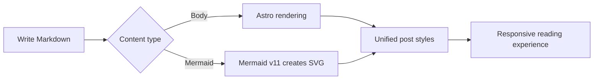
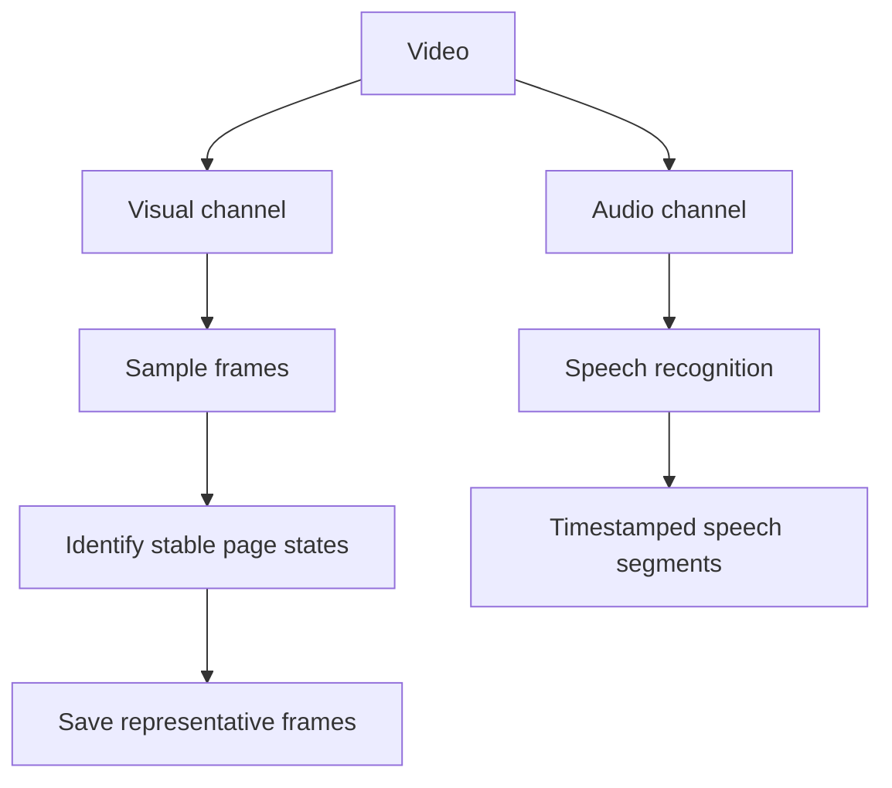

This is not a tutorial that must be read from beginning to end. It is a Markdown showcase prepared for **Usvan**. Scroll through it to explore typography, table-of-contents behavior, syntax highlighting, lazy-loaded images, and how content elements look in light and dark themes.

<!-- more -->


## Starting with Ordinary Body Text

Good reading experiences are usually understated. They keep body text at a comfortable width, give paragraphs room to breathe, and let links, emphasis, and notes blend naturally into each sentence. For example, visit the [Astro website](https://astro.build/), use **bold text for emphasis**, *italics for tone*, or `inline code` for filenames and commands.

When English, numbers such as 2026, and symbols such as `@astrojs/mdx` appear together, text should remain stable and clear. Longer paragraphs reveal line height and wrapping: design is not about decorating everything with more complexity, but about giving content hierarchy and helping readers pause or continue naturally.

> A good theme should not steal attention from the post.
> It is more like a quiet gallery: it manages light, distance, and direction while leaving the stage to the content.

### Text Details

Here are some common inline semantics:

- **This is bold text**, useful for conclusions and keywords.
- *This is italic text*, useful for tone and titles.
- ~~This is strikethrough text~~, useful for showing previous ideas.
- `const theme = 'Usvan'` is an inline code sample.
- [This is an external link](https://docs.astro.build/), useful for observing hover and visited states.

---

## Lists and Information Hierarchy

Lists are one of the most common structures in long posts. Unordered lists suit parallel information:

- Clear content hierarchy
- Comfortable reading width
- Stable table-of-contents positioning
  - Nested items should remain easy to identify
  - Indentation should not disrupt the body text
- Mobile-friendly interaction

Ordered lists are better for explaining steps:

1. Write down the post's most important conclusion.
2. Use headings to establish clear sections.
3. Add images, code, or data as evidence.
4. Finally, check the mobile reading experience.

Task lists can show completion status:

- [X] Prepare the post structure
- [X] Add original demo images
- [X] Cover the main Markdown styles
- [ ] Write your next post

## Images and Long-Page Rhythm

Images are not only decorative; they also change the rhythm of scrolling through a long page. This image sits in the middle of the post and lets you observe image corners, maximum width, lazy-loading placeholders, and whether table-of-contents anchors remain stable after loading.


Here is a 9:16 portrait image for observing proportional scaling on desktop and mobile; click it to view the full size in the lightbox.


### Why Image Dimensions Matter

When the browser knows an image's dimensions before downloading it, it can reserve the correct space and reduce layout shifts. This site's Markdown image processing adds dimension information and uses lazy loading to balance initial-load speed with scrolling.

> **Tip**: To test contents navigation, click the “Code Showcase” or “Mathematical Formulas” section below, then scroll quickly up and down to observe highlighting and the final scroll position.

## Code Showcase

Inline code suits short snippets such as `npm run dev`. Full code blocks demonstrate syntax highlighting, horizontal scrolling, and long-line wrapping.

```ts
type Post = {
  title: string;
  description: string;
  tags: string[];
};

const featuredPost: Post = {
  title: 'Designing a calm reading experience',
  description: 'Content first, decoration second.',
  tags: ['Astro', 'Design', 'Markdown'],
};

export const formatTitle = ({ title }: Post) =>
  `${title} — Usvan`;
```

Command-line output can be shown as well:

```bash
npm install
npm run dev
npm run build
```

Here is a long line for checking behavior on narrow screens:

```js
const message = posts.filter((post) => post.data.tags.includes('Astro')).map((post) => post.data.title).join(' · ');
```

## Table Showcase

Tables are useful for information that needs horizontal comparison. On phones, they should remain readable rather than forcing the whole page to become wider.

| Element    | Purpose              | Location |
| :--------- | :------------------- | -------: |
| Headings and contents | Establish a reading path | Several |
| Images                | Show visuals and lazy loading | 2 images |
| Code blocks           | Demonstrate syntax highlighting | 3 groups |
| Tables                | Compare structured information | 1 table |
| Math formulas         | Technical article layout | 2 groups |

## Mathematical Formulas

Inline formulas can fit naturally into a sentence, such as the area of a circle, $A = \pi r^2$. Standalone formulas are useful for showing a fuller derivation:

$$
\operatorname{softmax}(x_i) = \frac{e^{x_i}}{\sum_{j=1}^{n} e^{x_j}}
$$

Here is another classic, Euler's identity:

$$
e^{i\pi} + 1 = 0
$$

## Deeper Heading Levels

This section is specifically for observing contents indentation and heading spacing.

### Level-3 Heading: Relationships Between Components

Body text, images, and code blocks are not isolated from one another. Together they determine the visual density of a post and influence the rhythm readers feel while scrolling.

#### Level-4 Heading: A Finer Note

Real posts do not need to use deep heading levels often, but the theme should still give them clear, restrained visual distinctions.

### Level-3 Heading: Responsive Reading

On desktop, contents help readers jump quickly; on mobile, content width, touch targets, and code and tables that do not overflow matter more.

## Mermaid Diagrams

Use a standard fenced code block to render Mermaid v11 diagrams online; diagrams automatically adapt to the blog's light and dark themes.



### Vertical Flowchart (Print Example)

This diagram demonstrates adaptive sizing for vertical flowcharts on the web and in PDFs:



## Collapsible Content and Additional Notes

Native HTML can also be used alongside Markdown:

<details>
  <summary>Click to expand additional content</summary>

  This text is collapsed by default and can hold answers, supplementary material, or information that does not interrupt the main reading flow.

</details>

> [!NOTE]
> If your Markdown toolchain does not enable GitHub-style alert boxes, this gracefully falls back to a normal blockquote, which also verifies style compatibility.

## Conclusion

This post now covers the most common content types on the Usvan post page. Keep it as a theme demo or use it as a visual regression page when modifying styles later.

If headings, paragraphs, lists, quotes, images, code, tables, and formulas stay harmonious across light and dark themes and different screen widths, the theme is ready for real content.
